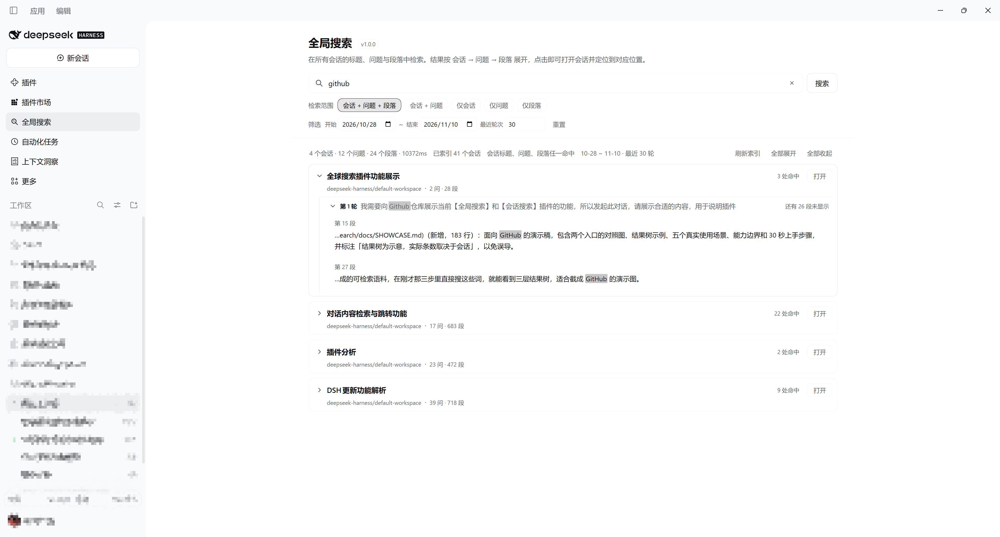
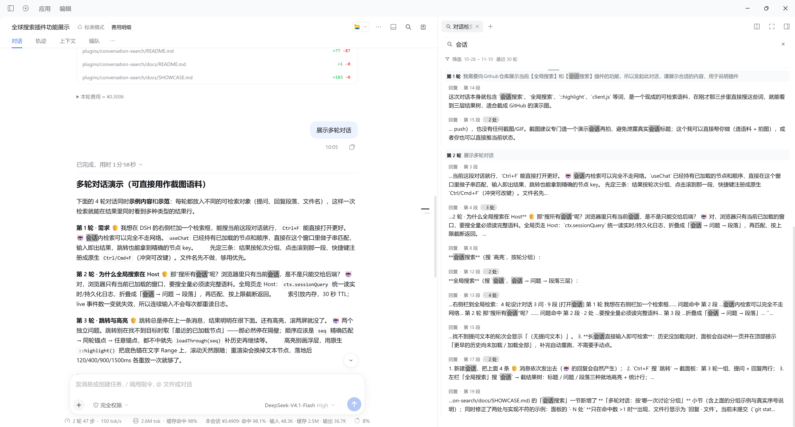

# dsh-chat-search

[](https://github.com/timefarer/dsh-chat-search/actions/workflows/ci.yml)
[](LICENSE)

[简体中文](README.md) | English

**Global conversation search and filtering for DeepSeek Harness (`dsh`)**: search chat history
across every session or just the open one, matching both **paragraph text** and **file names** —
find it even when you only remember the file. Narrow results with **date range** and **each
session's recent turns**; hits expand as a **session → question → paragraph** tree, and a click
lands on the match with the words highlighted. Defaults to the last 14 days and the latest 30
turns per session; leave either empty to search everything.

> Status: 1.2.0, targets DSH ≥ 0.2.0-rc.1. Best effort — the plugin leans on a few undocumented
> DOM anchors and client services, so a future DSH release may break it; fixes follow quickly.

## Screenshots

**Global search**: a full page in the main area, with scope chips, the filter window, and the
session → question → paragraph tree.



**In-conversation search**: the right-sidebar panel, grouped by turn, showing the matched
paragraphs, file names and hit counts.



## Why this one

- **File names are searchable** — attachments, tool-call path arguments and `apply_patch`
  headers are indexed, and a file hit is a result row of its own. When the text is forgotten but
  the file name is not, this is the part that matters.
- **Structured results** — session → question → paragraph, with five scope modes; you see which
  question an answer belongs to before choosing the paragraph.
- **Controlled range** — a date window and "last N turns per session", so "the last two weeks"
  or "the last 30 turns" is a filter instead of something you eyeball afterwards.
- **Readable at a glance** — global search takes over the main area as a full result tree, not a
  panel squeezed into a corner.
- **One numbering on both sides** — turns use the DSH Turn number and paragraph numbers run
  across every reply message of a Turn, so the global page and the panel show the same
  "Turn N / Paragraph M".
- **Visible landing** — a click opens the session, pages in missing history, resolves the turn,
  then highlights the matched words with the browser's own find styling that follows scrolling;
  the landed paragraph also gets a **blue selection wash**, distinct from the amber keywords.
- **One keystroke** — `Ctrl/Cmd+F` opens the panel; Enter jumps to the first hit.

## Install

**In the app (recommended)**

DSH → **Plugins** page → **Add plugin** → search `dsh-chat-search` → **Install**.

**DSH CLI**

```sh
dsh plugin add dsh-chat-search
```

Add `--profile <name>` to target a specific profile (desktop builds usually use `desktop`,
plain `dsh web` uses `web`):

```sh
dsh plugin --profile desktop add dsh-chat-search
```

**From source (development)**

```sh
dsh plugin add link:<path-to-this-directory>
```

> **Restart DSH completely** after installing: the Host half is loaded once at process start, so
> a page refresh is not enough (release desktop builds have no reload menu).

## Usage

1. Click the magnifier in the conversation header, or press `Ctrl/Cmd+F`;
2. Type — results group by turn and show role, paragraph index and hit count;
3. Click a hit; the conversation scrolls to that paragraph and the matched words are marked;
4. Narrow the window with the filter line (`10-27 ~ 11-09 · last 30 turns`);
5. For other sessions, open **Global search** in the left rail and read the
   session → question → paragraph tree.

## Filter window

| Dimension | Default | Empty | Semantics |
|---|---|---|---|
| Date range | last 14 days (today included) | either end empty = unbounded | the **turn's user-message time**, not the session creation time |
| Turn count | last 30 turns | empty or 0 = unlimited | the last N turns of each session, then the date filter |

- Global search clips each session separately; the in-conversation panel applies it to the
  current session only.
- "Turn N" in results is always the real ordinal inside the session, so filtering never shifts
  where a jump lands.
- Changing a filter re-runs the current search immediately.

## Privacy

- Reads **local** session logs only, through the Host's `sessionQuery` service.
- Writes two small files under `<DSH_PROFILE_DIR>/plugin-data/conversation-search/`:
  `recent.json` (last 8 queries) and `filters.json` (the window). Nothing else.
- Sends **no network requests**. The Host route rejects calls without the browser credential (401).

## Compatibility and limits

- Targets DSH `>=0.2.0-rc.1`; uses the official `slots`, `sidebar`, `shortcuts`, `webServer`,
  `sessionQuery` and `uiWorkspace` APIs, plus the `data-chat-node-key` / `data-chat-flow` DOM
  anchors to locate a message.
- The index is rebuilt from `sessionQuery` with a 30 s TTL; corpora are capped at 400 sessions /
  8M characters, and one response returns at most 30 sessions × 12 questions × 8 paragraphs.
- No regex mode, no injected-context toggle, no HTTP search endpoint for other tools.
- The index is built on the Host main thread, so the first search of a very large history has
  one noticeable wait; later searches hit the cache.
- Debug logging: run `__dshChatSearchDebug = true` in DevTools and look for `[dsh-chat-search]`.

## Development

```powershell
npm run check   # node --check on both halves
npm test        # headless Host suite + headless client suite
```

Both suites are dependency-free: the Host suite folds synthetic session logs and drives the HTTP
route; the client suite loads `client.js` with a minimal React runtime and asserts the
registrations, the panel tree, the global page, the jump payload, the filter window and the
shortcut.

Design notes are in Chinese under [`docs/`](docs/): [`DESIGN.md`](docs/DESIGN.md) (architecture
and algorithms), [`SHOWCASE.md`](docs/SHOWCASE.md) (walkthrough), plus requirements and bug
history.

## License

[MIT](LICENSE)
