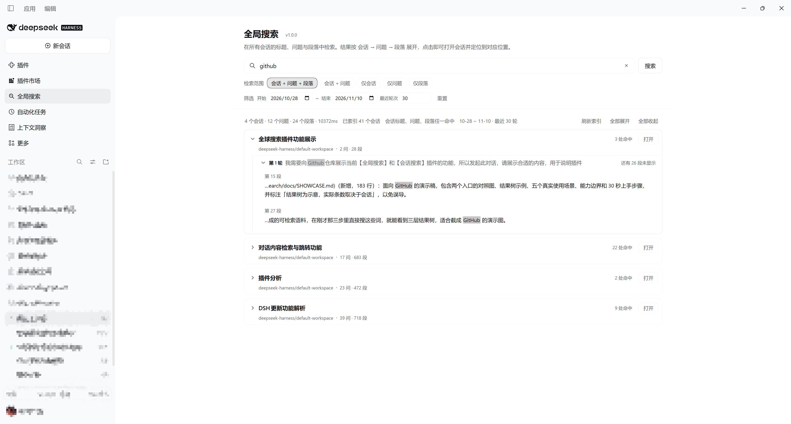
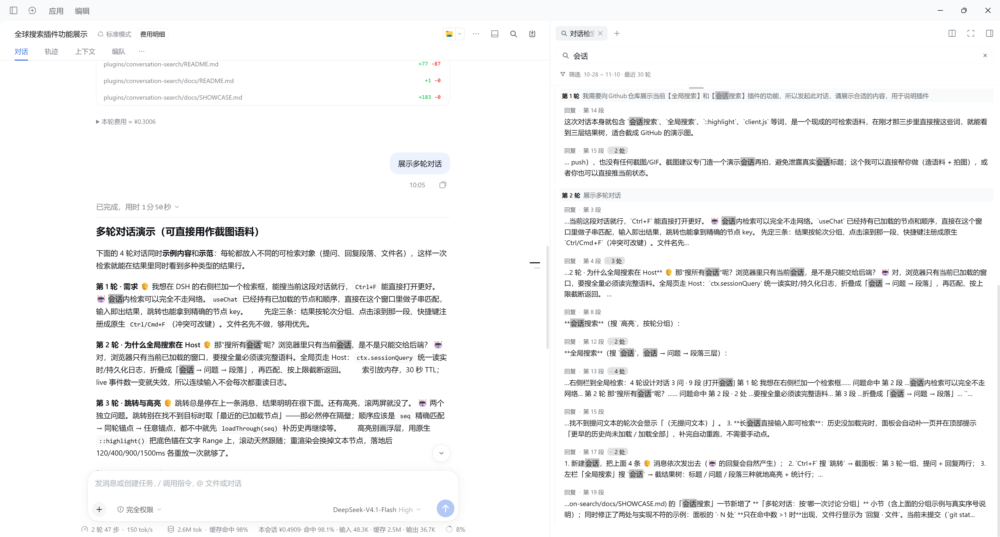

# dsh-chat-search

[](https://github.com/timefarer/dsh-chat-search/actions/workflows/ci.yml)
[](LICENSE)

简体中文 | [English](README.en.md)

**DeepSeek Harness（`dsh`）的全局搜索与会话搜索插件**：在所有会话或当前会话中搜索聊天记录，
同时**检索正文段落与文件名**——忘了内容、只记得文件名也能找到；支持按**日期范围**与每个会话的
**最近轮次**筛选、过滤；结果按「会话 → 问题 → 段落」展开，跳转后自动定位并高亮命中词。
默认只搜最近 14 天、每会话最近 30 轮，清空任一项即可不限范围。

> 状态：1.2.3，目标 DSH ≥ 0.2.0-rc.1。尽力维护——插件依赖少量未公开的 DOM 锚点与客户端服务，
> DSH 升级后可能失效，届时会尽快跟进。

## 截图

**全局检索**：主内容区整页，范围胶囊 + 筛选窗口 + 会话 → 问题 → 段落三层结果。



**会话内检索**：右侧栏面板，按轮次分组，显示命中的段落、文件名与命中次数。



## 为什么是它

- **搜得到文件名**——用户附件、工具调用的路径参数、`apply_patch` 的文件头都进索引，文件名单独成行。
  正文忘了、文件名还记得的时候，这条最关键。
- **结果有结构**——会话 → 问题 → 段落三层，5 档范围可切换；先看清"这段是在回答哪个问题"，再决定点哪一段。
- **范围可控**——日期窗口 + 每会话最近 N 轮，把"最近两周、最近 30 轮"这种真实检索习惯做成筛选条件，
  而不是搜完一大堆再肉眼过滤。
- **打开就能读**——全局检索占满主内容区，是一页完整的结果树，不是挤在角落的浮层。
- **落地看得见**——点击后自动补齐历史、定位到对应轮次，命中词用浏览器原生高亮标出并跟随滚动。
- **不打断手**——`Ctrl/Cmd+F` 直接唤起面板，回车跳到第一条。

## 功能

- **两个入口**——右侧栏面板检索当前对话；左栏整页检索全部会话。
- **5 档范围**——会话+问题+段落（默认）、会话+问题、仅会话标题、仅问题、仅段落。
- **文件名是一等公民**——用户附件、工具调用的路径参数、`apply_patch` 的文件头都会被索引，
  文件命中单独成行。
- **筛选窗口**——日期范围（默认最近 14 天）+ 每会话最近 N 轮（默认 30）；任一端留空即不限；
  配置会保存，重启后沿用。
- **两处编号一致**——轮次用 DSH 自己的 Turn 号，段落号在一个 Turn 内跨回复消息连续，全局页与会话内面板看到的是同一个「第 N 轮 / 第 M 段」。
- **跳转与高亮**——打开会话、补齐缺失的历史、按锚点定位到轮次，再用浏览器原生高亮标出命中词；落地的那一段另有**蓝色选中底色**，和琥珀关键词不撞色。
- **快捷键**——`Ctrl/Cmd+F` 打开面板；回车跳第一条；↑/↓ 在结果间移动。
- **中英双语**——跟随宿主语言；明暗主题自适应。

## 安装

**应用内安装（推荐）**

DSH → **插件** 页 → **添加插件** → 搜索 `dsh-chat-search` → **安装**。

**DSH CLI 安装**

```sh
dsh plugin add dsh-chat-search
```

要装到指定 profile 时加 `--profile <名称>`（桌面端是 `desktop`，普通 `dsh web` 是 `web`）：

```sh
dsh plugin --profile desktop add dsh-chat-search
```

**从源码安装（开发用）**

```sh
dsh plugin add link:<本目录路径>
```

> 安装后**完全退出并重新打开 DSH**：Host 半只在进程启动时加载一次，刷新页面不够
> （桌面正式版没有「刷新页面」菜单）。

## 使用

1. 点会话标题栏的放大镜，或按 `Ctrl/Cmd+F`；
2. 输入关键词，结果按轮次分组，显示角色、第几段、命中次数；
3. 点一条结果——对话会滚到对应段落并高亮命中词；
4. 用筛选行收窄窗口（如 `10-27 ~ 11-09 · 最近 30 轮`）；
5. 需要跨会话时，点左栏「全局搜索」，结果按 会话 → 问题 → 段落 展开。

## 筛选窗口

| 维度 | 默认 | 为空 | 语义 |
|---|---|---|---|
| 日期范围 | 最近 14 天（含今天） | 任一端留空 = 该端不限 | 按该轮**用户消息时间**，不是会话创建时间 |
| 对话轮次 | 最近 30 轮 | 留空或 0 = 不限 | 每个会话取最后 N 轮，再按日期过滤 |

- 全局检索对**每个会话**分别裁剪；会话内检索只作用于**当前会话**。
- 结果里的「第 N 轮」始终是会话内的真实序号，跳转不会因筛选而错位。
- 改动筛选会立刻重跑当前检索，不需要重新输入关键词。

## 隐私

- 只通过宿主的 `sessionQuery` 读取**本地**会话日志。
- 只在 `<DSH_PROFILE_DIR>/plugin-data/conversation-search/` 下写两个小文件：
  `recent.json`（最近 8 条查询）与 `filters.json`（筛选窗口），别无其他。
- **不发起任何网络请求**；Host 接口要求浏览器凭据，无凭据返回 401。

## 兼容性与限制

- 目标 DSH `>=0.2.0-rc.1`；使用官方 `slots` / `sidebar` / `shortcuts` / `webServer` /
  `sessionQuery` / `uiWorkspace` 接口，以及 `data-chat-node-key`、`data-chat-flow` 两个 DOM 锚点。
- 索引以 30 秒 TTL 从 `sessionQuery` 重建；语料上限 400 会话 / 800 万字符；单次响应最多
  30 会话 × 12 问题 × 8 段落。
- 没有正则模式、没有「包含注入上下文」开关、不对外提供 HTTP 检索接口。
- 索引在 Host 主线程构建（30 秒 TTL），会话特别多时首次检索会有一次明显的等待；之后走缓存。
- 排查用：在 DevTools 执行 `__dshChatSearchDebug = true`，再看 `[dsh-chat-search]` 开头的日志。

## 开发

```powershell
npm run check   # 两个文件 node --check
npm test        # Host 无头测试 + 客户端无头测试
```

两套测试都不依赖第三方包：Host 侧折叠合成日志、驱动 HTTP 路由；客户端侧用极简 React 运行时加载
`client.js`，断言注册项、面板树、全局页、跳转载荷、筛选窗口与快捷键。

设计资料（中文）：[`docs/SHOWCASE.md`](docs/SHOWCASE.md)（功能演示与真实场景）、
[`docs/DESIGN.md`](docs/DESIGN.md)（架构与算法）、需求与缺陷记录：
[`docs/REQUIREMENTS.md`](docs/REQUIREMENTS.md)、[`docs/BUGS.md`](docs/BUGS.md)。

## English summary

Conversation search for DeepSeek Harness (`dsh`): a right-sidebar panel and a full-page global
search, paragraph- and **file-name** matching, a session → question → paragraph tree, a date/turn
filter window, and a jump that keeps the matched words highlighted. Targets DSH ≥ 0.2.0-rc.1;
MIT. Design notes are in Chinese under [`docs/`](docs/).

## License

[MIT](LICENSE)
